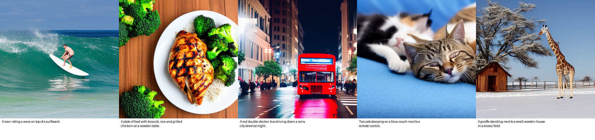

# text2image-diffusion

Text-to-image generation with CLIP text embeddings and Stable Diffusion, trained and evaluated on a curated MS-COCO caption subset.
See [docs/proposal.md](docs/proposal.md) for the full proposal ([PDF](docs/proposal.pdf)).

## Team
| Member | Role |
|---|---|
| Gokul Chandar Kumaran | Modeling lead & integration |
| Loalith Madala | Data lead |
| Yagna Praneeth Reddy Panguru | Evaluation lead |

## Layout
```
scripts/
  check_env.py          # verify torch / CUDA / diffusers / CLIP
  download_coco.py      # COCO 2017 val images + captions -> data/raw/
  preprocess.py         # clean, filter, resize -> data/processed/ (metadata.jsonl, stats.json)
  generate_samples.py   # 5 prompt->image runs + CLIPScore -> outputs/samples/
notebooks/
  01_text_to_embedding_baseline.ipynb   # tokenization, 77x768 conditioning, Recall@K, CLIPScore
docs/proposal.md
```

## Setup
Use Python 3.11 or 3.12. PyTorch wheels may not be available yet for newer versions.
```bash
python -m venv .venv
.venv\Scripts\activate            # Windows  (source .venv/bin/activate on macOS/Linux)
pip install torch torchvision --index-url https://download.pytorch.org/whl/cu128   # RTX 50-series needs cu128
pip install -r requirements.txt
python scripts/check_env.py
```

## Run Milestone 1
```bash
python scripts/download_coco.py           # ~1 GB
python scripts/preprocess.py --n 5000     # -> ~5k clean pairs
jupyter notebook notebooks/01_text_to_embedding_baseline.ipynb
python scripts/generate_samples.py        # ~4 GB model download on first run
```

> **Windows note:** PyTorch's CUDA DLLs fail to load (`WinError 206`) if the venv path is too long. Keep the venv at a short path, e.g. `C:\venvs\t2i`.

## Milestone 1 results
Tested on an RTX 5060 Laptop GPU (8 GB) with PyTorch 2.11 + cu128, Diffusers 0.42 and Transformers 5.22.

**Dataset:** 25,014 raw captions went in. Filtering dropped 247 duplicate captions, 2 that failed the length/token checks, and 74 images that were too small or too elongated. That leaves **4,926 pairs (4,434 train / 492 val)**, with captions averaging 12.8 words.

**Baseline (CLIP ViT-L/14, val split, real pairs):**
| Text→Image R@1 | R@5 | R@10 | CLIPScore |
|---|---|---|---|
| 0.669 | 0.913 | 0.970 | 26.14 ± 4.04 |

**5 prompt→image runs:** SD 1.5, fp16, DPM-Solver++, 30 steps, CFG 7.5, about 5.2 s per image.



| # | Prompt | CLIPScore |
|---|---|---|
| 1 | A man riding a wave on top of a surfboard. | 27.56 |
| 2 | A plate of food with broccoli, rice and grilled chicken on a wooden table. | 29.54 |
| 3 | A red double-decker bus driving down a rainy city street at night. | 27.32 |
| 4 | Two cats sleeping on a blue couch next to a remote control. | 25.82 |
| 5 | A giraffe standing next to a small wooden house in a snowy field. | 34.22 |
| | **Mean** | **28.89** |

**What we saw:** the in-distribution scenes come out well. The model struggles with composition: the bus has one deck instead of two, and the remote control is missing from run 4. These are targets for Phase 2 fine-tuning and evaluation. The generated images score higher than real COCO pairs (28.9 vs 26.1) because SD outputs tend to depict the prompt very literally, so CLIPScore alone isn't enough; we'll add FID and human ratings.

## Milestone 1 checklist
- [x] Dataset chosen: COCO val2017 (curated subset)
- [x] Cleaning and preprocessing: 4,926 pairs
- [x] Environment: PyTorch, Diffusers, and CLIP (`scripts/check_env.py` passes)
- [x] Baseline text→embedding notebook (executed, outputs saved)
- [x] 5 sample prompt→image runs (`outputs/samples/grid.png`, `runs.json`)
- [x] Repo initialized
